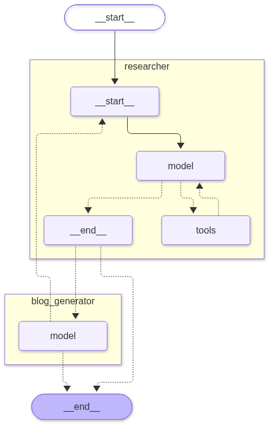

# Multi_Agent_RAG

A simple multi-agent system built with **LangGraph** where a **researcher agent** gathers information and a **blog writer agent** turns it into a detailed blog post.

## How It Works



1. **Researcher agent** searches two sources:
   - **Tavily** for live web search
   - **Internal notes** (`internal_docs.txt`) using a FAISS vector store (RAG)
2. The researcher passes its findings to the **Blog Generator agent**.
3. The blog agent writes the blog. If it needs more info, it hands control back to the researcher.
4. When any agent writes `FINAL ANSWER`, the workflow stops and the blog is printed.

## Tech Stack

- Python
- LangChain and LangGraph
- Sarvam AI (`sarvam-105b`) as the LLM
- FAISS and HuggingFace embeddings (`all-MiniLM-L6-v2`)
- Tavily Search

## Project Structure

```
Multi_Agent_RAG/
├── main.py             # agents, graph, and run logic
├── internal_docs.txt   # internal research notes used for RAG
├── graph.png           # graph visualization (auto-generated)
├── .env                # API keys
└── README.md
```

> Rename `main.py` to match your actual script name.

## Setup

1. Clone the repo
   ```bash
   git clone https://github.com/Pawankumarsani/Multi_Agent_RAG.git
   cd Multi_Agent_RAG
   ```

2. Install dependencies
   ```bash
   pip install langchain langgraph langchain-community langchain-huggingface \
       langchain-tavily langchain-sarvam langchain-text-splitters \
       faiss-cpu sentence-transformers python-dotenv
   ```

3. Create a `.env` file with your API keys
   ```
   TAVILY_API_KEY=your_tavily_key
   SARVAM_API_KEY=your_sarvam_key
   ```

4. Add your notes to `internal_docs.txt`

## Run

```bash
python main.py
```

The script saves the graph image to `graph.png` and prints the final blog in the terminal.

To change the topic, edit the message in the `graph.invoke(...)` call at the bottom of the script.

## Notes

- The Sarvam rate limiter is set to 0.2 requests per second to avoid hitting API limits.
- `recursion_limit` is set to 12 to stop the agents from looping forever.

## Author

**Pawan**
[GitHub](https://github.com/Pawankumarsani) · [LinkedIn](https://linkedin.com/in/pawan-sani)